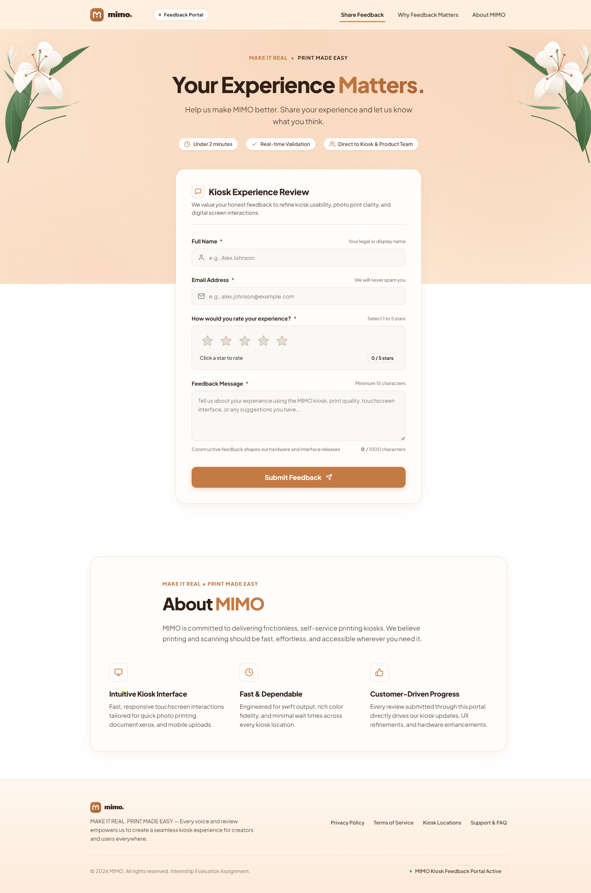
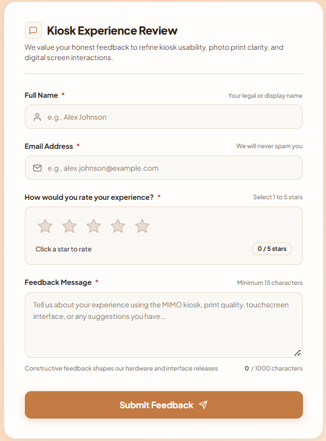
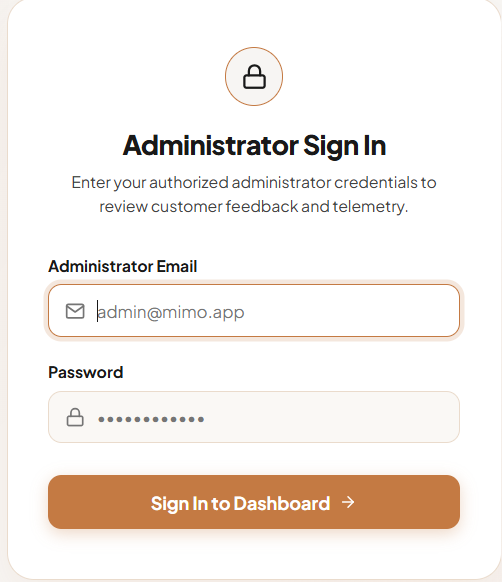
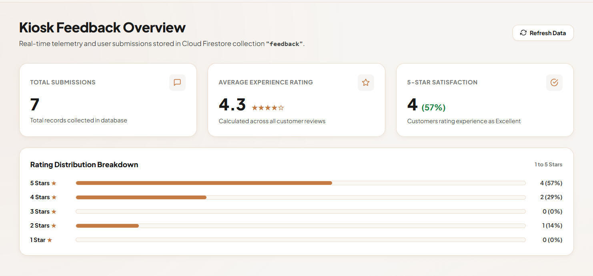
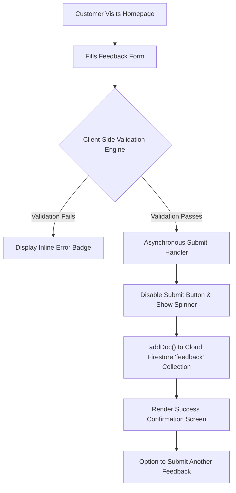
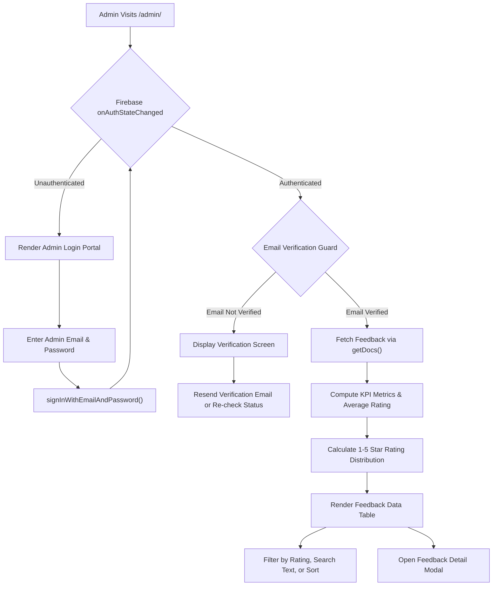

# MIMO Feedback Collection Website 🚀

A modern, responsive web application designed for collecting, validating, and managing customer experience feedback for **MIMO self-service printing kiosks**. Built with Vanilla Web technologies (HTML5, CSS3, ES6+ JavaScript modules), Firebase Modular SDK v10 (Authentication & Cloud Firestore), and configured for Firebase Hosting.

The application features a public customer feedback portal with client-side validation and a separate, authenticated Administrative Analytics Dashboard.

---

## 📌 Table of Contents

1. [Project Overview](#-project-overview)
2. [Key Features](#-key-features)
3. [Technology Stack](#-technology-stack)
4. [Screenshots](#-screenshots)
5. [System Architecture & Workflow](#-system-architecture--workflow)
6. [Firebase Configuration & Setup Instructions](#-firebase-configuration--setup-instructions)
7. [How to Run Locally](#-how-to-run-locally)
8. [Live Demo](#-live-demo)
9. [GitHub Repository](#-github-repository)
10. [Future Enhancements](#-future-enhancements)
11. [Author](#-author)

---

## 📖 Project Overview

The **MIMO Feedback Collection Website** serves as a digital bridge between physical kiosk hardware usage and actionable customer insights. Tailored to reflect the visual identity of physical MIMO printing and xerox kiosks, it provides a fast, accessible feedback submission process for customers on any device, alongside an administrative portal for product teams.

### Core Highlights:
- **Frictionless Customer Experience:** Public feedback submission requiring no account creation or login.
- **Client-Side Data Validation:** Real-time form checks for full names, email addresses, 1–5 star ratings, and character-bounded feedback messages.
- **Administrative Intelligence:** Role-gated dashboard calculating total submissions, average rating scores, 5-star review ratios, rating breakdown bars, and multi-criteria search filtering.
- **Brand Cohesion:** Visual design featuring warm caramel orange accents (`#C47A43`), creamy background gradients (`#FFF1E3`, `#FCE3CC`), deep espresso typography (`#302016`), and botanical white lilies with natural green foliage.
- **Zero Framework Bloat:** Developed in native HTML5, CSS3, and ES6+ JavaScript for fast load times and minimal resource consumption.

---

## ✨ Key Features

### Customer Feedback Portal (`/`)
- **Full Name & Email Collection:** Input fields with SVG iconography, trim sanitization, error messages, and format validation.
- **Interactive 1–5 Star Rating:** Accessible keyboard navigation (Tab, Arrow keys, Home, End), hover previews, dynamic descriptive labels (*1: Poor* to *5: Excellent*), and a live score badge (*X / 5 stars*).
- **Feedback Message with Character Counter:** Multi-line textarea enforcing a 15-character minimum and 1,000-character maximum, paired with a dynamic counter.
- **Cloud Firestore Storage:** Direct integration with Firebase Modular SDK v10 writing to the `"feedback"` collection with server-generated timestamps (`serverTimestamp()`).
- **Submission State Handling:** Interactive submit button with an animated CSS spinner that disables during submission to prevent duplicate entries.
- **Confirmation Screen:** Instant success screen displaying an animated checkmark, a summary of submitted information, and a reset button to submit another response.
- **About MIMO Section:** Three feature pillars detailing the kiosk experience: *Intuitive Kiosk Interface*, *Fast & Dependable*, and *Customer-Driven Progress*.

### Administrator Portal & Dashboard (`/admin/`)
- **Administrator Authentication:** Protected login interface using Firebase Authentication (`signInWithEmailAndPassword`) with session monitoring via `onAuthStateChanged`.
- **Email Verification Guard:** Restricts administrative dashboard access to verified administrator accounts, complete with status checks and a 60-second cooldown timer for verification email resends.
- **KPI Metrics Cards:** Instant overview calculating Total Feedback Count, Average Rating score (e.g., `4.8 / 5.0`), and 5-Star review totals with percentage share.
- **Rating Distribution Breakdown:** Visual horizontal progress bars from 5 stars down to 1 star with percentage fills and exact record counts.
- **Search & Filter Engine:**
  - Real-time text search across submitter names, email addresses, and message contents.
  - Dropdown filter by star rating (*All Ratings*, *5 Stars*, *4 Stars*, *3 Stars*, *2 Stars*, *1 Star*).
  - Sorting options: *Newest First*, *Oldest First*, *Highest Rating*, *Lowest Rating*.
  - Quick *"Clear Filters"* action and live results counter.
- **Feedback Detail Modal:** Click-to-view modal displaying the complete submission profile, timestamp, rating, message text, and Firestore Document ID.
- **Safe DOM Rendering:** User content is rendered using safe DOM properties (`textContent`) and programmatic element creation to protect against Cross-Site Scripting (XSS).

---

## 🛠 Technology Stack

| Layer | Technology | Purpose |
| :--- | :--- | :--- |
| **Frontend Structure** | **HTML5** | Semantic markup, form controls, and accessible ARIA attributes |
| **Styling & Theme** | **CSS3** | Custom properties (design tokens), responsive CSS Grid, Flexbox, smooth transitions |
| **Client Logic** | **JavaScript (ES6+)** | Native ES modules, async/await operations, DOM manipulation, form validation |
| **Authentication** | **Firebase Auth** | Administrator email/password authentication & email verification gating |
| **Database** | **Cloud Firestore** | NoSQL document database for structured customer feedback storage |
| **Hosting** | **Firebase Hosting** | Global CDN hosting, SSL certification, clean URLs, and custom cache headers |
| **Version Control** | **Git & GitHub** | Source code management and repository tracking |

---

## 📸 Screenshots

### Customer Homepage


### Feedback Form


### Administrator Login


### Administrator Overview


---

## 🏗 System Architecture & Workflow

### Customer Feedback Submission Workflow



### Administrator Dashboard Workflow



---

## 🔥 Firebase Configuration & Setup Instructions

Follow these steps to connect the website to your own Firebase project.

### 1. Create a Firebase Project

1. Open the [Firebase Console](https://console.firebase.google.com/).
2. Click **Add project** (or **Create a project**).
3. Enter a project name (e.g., `mimo-feedback-website`) and continue.
4. Set up Google Analytics (optional) and click **Create project**.

---

### 2. Enable Email/Password Authentication

1. In the Firebase Console left menu, navigate to **Build > Authentication**.
2. Click **Get started**.
3. Under the **Sign-in method** tab, select **Email/Password**.
4. Enable the **Email/Password** provider and click **Save**.
5. Switch to the **Users** tab, click **Add user**, and create the administrator account credentials.

---

### 3. Cloud Firestore Security Architecture

In Cloud Firestore, customer feedback records must be strictly protected against unauthorized access and tampering:

- **Public Feedback Submissions (`create`):** Public visitors can submit feedback documents into the `"feedback"` collection without logging in. Every incoming submission must pass strict server-side validation rules enforced in Firestore (valid field types, minimum and maximum character limits, rating integers between 1 and 5, and request timestamp matching).
- **Access Control & Administrator Authorization (`read`, `update`, `delete`):**
  - Public, unauthenticated, and unauthorized users are denied read, update, and delete access to protect customer privacy and data integrity.
  - The administrator's production Firestore security rules must explicitly authorize the verified and allowlisted administrator account, while denying unauthorized reads, updates, and deletes.
  - Developers configuring this project should set up their Firestore security rules in the Firebase Console according to their own Firebase project settings and specific administrator identity.

---

### 4. Configure Web App Credentials (`firebase.js`)

1. In the Firebase Console, click the **Settings gear (⚙️)** next to *Project Overview* and select **Project settings**.
2. In the **General** tab, scroll to **Your apps** and select the **Web (`</>`)** icon.
3. Register the web application.
4. Copy the `firebaseConfig` object provided.
5. In your local project, open `firebase.js` and update the configuration object with your project credentials:

```javascript
// firebase.js
export const firebaseConfig = {
  apiKey: "YOUR_API_KEY",
  authDomain: "YOUR_PROJECT_ID.firebaseapp.com",
  projectId: "YOUR_PROJECT_ID",
  storageBucket: "YOUR_PROJECT_ID.firebasestorage.app",
  messagingSenderId: "YOUR_MESSAGING_SENDER_ID",
  appId: "YOUR_APP_ID"
};
```

> [!IMPORTANT]
> Never commit private API secrets, service account credentials, or database administrative keys to public version control. Web app configuration keys identify your Firebase project with client SDKs; Firestore Security Rules enforce access control.

---

### 5. Configure Firebase Hosting

The repository includes pre-configured `firebase.json` and `.firebaserc` files.

1. **Install Firebase CLI:**
   ```bash
   npm install -g firebase-tools
   ```

2. **Log In to Firebase:**
   ```bash
   firebase login
   ```

3. **Select Your Project:**
   ```bash
   firebase use YOUR_PROJECT_ID
   ```

4. **Deploy Hosting:**
   ```bash
   firebase deploy --only hosting
   ```

---

## 💻 How to Run Locally

Because the application uses native browser ES Modules (`import`/`export`), it must be served through an HTTP/HTTPS server origin rather than loaded via direct `file://` access.

### Option 1: Python Built-in HTTP Server (Recommended)
Open a terminal in the project root directory:
```bash
python -m http.server 5000
```
Open your browser to:
- **Customer Portal:** `http://localhost:5000/`
- **Admin Dashboard:** `http://localhost:5000/admin/`

---

### Option 2: Node.js `npx serve`
```bash
npx serve .
```
Access the URL displayed in your terminal (typically `http://localhost:3000`).

---

### Option 3: VS Code Live Server
1. Open the project folder in **Visual Studio Code**.
2. Install the **Live Server** extension by *Ritwick Dey*.
3. Right-click `index.html` and choose **Open with Live Server**.

---

### Option 4: Firebase CLI Hosting Emulator
```bash
firebase emulators:start --only hosting
```
Access `http://localhost:5000` to preview your local build in an environment mimicking Firebase Hosting.

---

## 🌐 Live Demo

- **Customer Feedback Website:** [https://mimo-feedback-website.web.app/](https://mimo-feedback-website.web.app/)
- **Admin Portal:** [https://mimo-feedback-website.web.app/admin/](https://mimo-feedback-website.web.app/admin/)

---

## 📦 GitHub Repository

- **Repository URL:** [https://github.com/RakeshBasavarajAngadi/MIMO-Feedback-Website](https://github.com/RakeshBasavarajAngadi/MIMO-Feedback-Website)

Clone the repository:
```bash
git clone https://github.com/RakeshBasavarajAngadi/MIMO-Feedback-Website.git
cd MIMO-Feedback-Website
```

---

## 📁 Project Directory Structure

```text
MIMO-Feedback-Website/
├── .firebaserc              # Firebase project binding configuration
├── .gitignore               # Git exclusions for operating system and cache files
├── firebase.js              # Firebase SDK initialization and Firestore submission module
├── firebase.json            # Firebase Hosting configuration and caching headers
├── index.html               # Public customer feedback portal
├── README.md                # Project documentation and guide
│
├── admin/                   # Dedicated Administrator Portal
│   ├── index.html           # Administrator login and analytics dashboard UI
│   ├── css/
│   │   └── admin.css        # Admin portal styling and dashboard layout
│   └── js/
│       └── admin.js         # Authentication observer, analytics calculation, and table logic
│
├── assets/                  # Visual Assets & Branding
│   └── images/
│       ├── botanical-lily-left.svg   # Left hero botanical lily illustration
│       ├── botanical-lily-right.svg  # Right hero botanical lily illustration
│       ├── favicon.svg               # Browser tab favicon
│       └── logo.svg                  # MIMO brand logo
│
├── css/
│   └── style.css            # Customer website stylesheet & design tokens
│
├── js/
│   └── script.js            # Customer form validation and submission handling
│
└── screenshots/             # Documentation Screenshots
    ├── admin-login.png      # Administrator login screen
    ├── admin-overview.png   # Administrator analytics dashboard overview
    ├── feedback-form.png    # Customer feedback form
    └── homepage.png         # Customer homepage hero section
```

---

## 🔮 Future Enhancements

- **CSV / Excel Export:** Allow administrators to export filtered feedback records for external reporting.
- **Automated Email Acknowledgments:** Integrate cloud email extensions to send confirmation receipts to submitters.
- **Kiosk Hardware Location Tagging:** Add kiosk location selection or machine IDs to pinpoint feedback origins.
- **Admin Dark Theme:** Provide a high-contrast dark color scheme for the administrator analytics interface.
- **Real-Time Snapshot Listeners:** Transition administrative queries from on-demand polling to real-time `onSnapshot` listeners.

---

## 👨‍💻 Author

**Rakesh Basavaraj Angadi**
- **GitHub:** [@RakeshBasavarajAngadi](https://github.com/RakeshBasavarajAngadi)
- **Project:** MIMO Internship Evaluation Assignment
- **Year:** 2026
